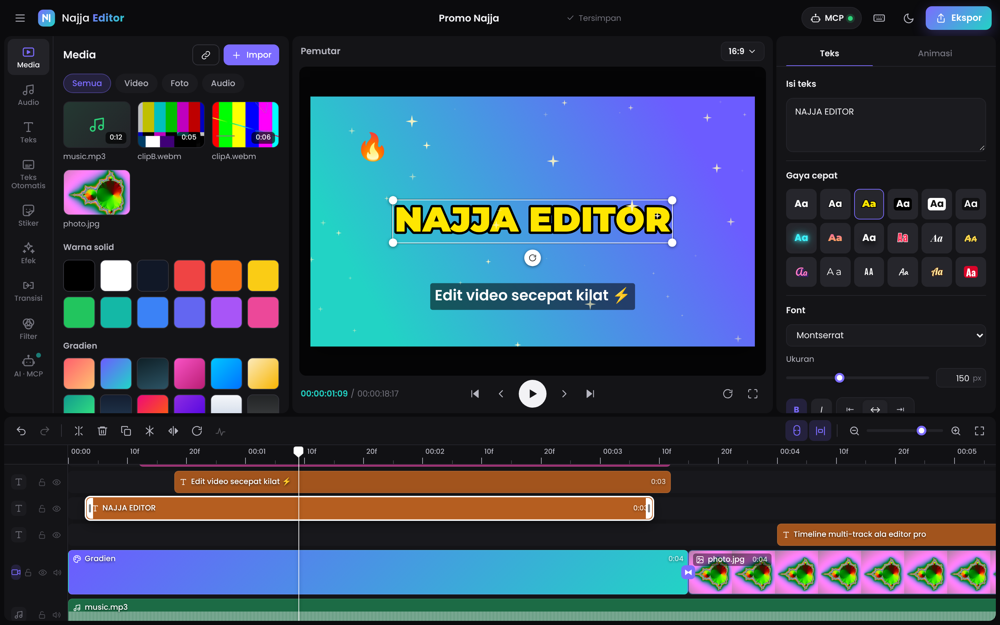

# Najja Editor

Editor video **berbasis web** bergaya CapCut, dengan **server MCP bawaan** sehingga AI agent (Claude Code, Claude Desktop, Cursor, dan lainnya) bisa mengedit video kamu secara langsung. Semua proses berjalan di browser kamu dan media tidak diunggah ke mana pun. Antarmukanya memakai font **Poppins** di semua bagian.



## Fitur

**Timeline multi-track**
- Track utama yang magnetis (klip otomatis menempel tanpa celah), ditambah track overlay, teks, audio, dan efek.
- Seret untuk memindah klip antar-track, tarik tepi klip untuk memangkas, dan snapping ke playhead serta tepi klip.
- Zoom (Ctrl + scroll), filmstrip thumbnail, dan waveform audio.
- Kunci, sembunyikan, dan bisukan per track.
- Pisah, hapus, duplikat, salin/tempel, bekukan frame, cermin, putar 90°, dan ekstrak audio. Undo/redo hingga 150 langkah.

**Pemutar**
- Pratinjau real-time di kanvas.
- Pilih, geser, ubah ukuran, dan putar objek langsung di kanvas, dengan garis bantu tengah.
- 8 rasio: 16:9, 9:16, 1:1, 4:5, 4:3, 3:4, 21:9, 2:1.
- Latar kanvas berupa warna atau **blur**.

**Video dan foto**
- Skala, posisi, rotasi, opasitas, 10 mode campuran, dan potong (crop).
- **Keyframe** untuk posisi, skala, rotasi, dan opasitas.
- **Chroma key** untuk menghapus latar hijau.
- Kecepatan 0.1x sampai 10x.
- Volume hingga 200%, fade in/out.

**Teks**
- 18 gaya, 12 template judul beranimasi, dan 12 font Google.
- Garis tepi, latar kotak, bayangan, dan gradien.

**Teks Otomatis**
- Subtitle dibuat dari naskah (dibagi rata) atau dari file `.srt`.

**Animasi**
- 14 animasi masuk, 13 animasi keluar, dan 9 animasi kombo (loop).

**Stiker**
- 80 emoji dan 9 label, misalnya SUBSCRIBE, SALE, dan LIVE.

**Efek, transisi, dan filter**
- 20 efek layar penuh: glitch, VHS, getar, konfeti, salju, cinta, kilau, sinematik, dan lainnya.
- 17 transisi.
- 18 filter dengan pengaturan intensitas.
- 10 penyesuaian warna: kecerahan, kontras, saturasi, eksposur, suhu, rona, hue, pudar, vinyet, dan blur.

**Audio**
- 8 efek suara dan 3 musik yang dibuat langsung di browser, tanpa file aset.
- Rekam **voiceover** dari mikrofon.

**Ekspor**
- Resolusi 480p hingga 4K, 24–60 fps, format MP4 (jika browser mendukung) atau WebM, dengan 3 pilihan kualitas.
- Bisa mengekspor seluruh video atau **hanya klip terpilih**.

**Proyek**
- Tersimpan otomatis di browser (IndexedDB), dengan daftar proyek dan thumbnail.
- Bisa disimpan sebagai `.json`.

**Tampilan**
- Tema gelap dan terang, panel yang bisa diubah ukurannya, dan tata letak untuk layar kecil.

**AI · MCP**
- 24 tool, log aktivitas AI langsung di editor, dan klip yang diubah AI berkedip di timeline.

## Menjalankan

Butuh **Node.js 18.17 ke atas**. Tidak ada dependensi, jadi tidak perlu `npm install`.

```bash
npm start
```

Editor akan terbuka di **http://localhost:3333**. Gunakan **Chrome atau Edge** terbaru untuk hasil terbaik.

## Hubungkan AI lewat MCP

Tambahkan Najja Editor ke **Claude Code** (lewat HTTP):

```bash
claude mcp add --transport http najja-editor http://localhost:3333/mcp
```

Untuk **Claude Desktop, Cursor, atau klien lain** (lewat stdio), tambahkan ke konfigurasi MCP:

```json
{
  "mcpServers": {
    "najja-editor": {
      "command": "node",
      "args": ["/path/lengkap/ke/najja-editor/mcp-stdio.js"]
    }
  }
}
```

Mode stdio otomatis menyalakan server web jika belum berjalan, lalu membuka editor di browser saat AI pertama kali memakai tool. Klien yang mendukung MCP lewat HTTP bisa langsung memakai `http://localhost:3333/mcp`.

Contoh perintah ke AI:

- *"Buat video promo 15 detik rasio 9:16 dari /Users/aku/Movies/produk.mp4. Beri judul 'DISKON 50%', efek konfeti, filter Vivid, lalu ekspor 1080p."*
- *"Tambahkan subtitle dari naskah ini, posisikan di bawah, gaya Subtitle."*
- *"Cek frame di detik 3. Kalau judulnya ketutupan stiker, pindahkan stikernya."*

### Daftar tool MCP

| Tool | Fungsi |
|---|---|
| `get_project`, `list_media`, `list_assets` | Membaca proyek, media, dan daftar ID aset (filter, efek, transisi, animasi, font, dan lainnya) |
| `new_project`, `set_project` | Membuat proyek baru, mengubah rasio, fps, dan latar |
| `import_media` | Mengimpor dari URL http(s) atau path file lokal, bisa langsung masuk timeline |
| `add_media_clip`, `add_text`, `add_subtitles`, `add_sticker`, `add_solid`, `add_effect` | Menambah klip |
| `update_clip` | Mengubah properti klip apa pun (waktu, posisi, teks, gaya, filter, penyesuaian, animasi, transisi, dan lainnya) |
| `apply_filter`, `apply_transition` | Memasang filter atau transisi ke satu klip, atau `"all"` untuk semua |
| `split_clip`, `delete_clip`, `move_clip`, `duplicate_clip` | Operasi timeline |
| `playback`, `history` | Putar, jeda, lompat, urungkan, dan ulangi |
| `get_frame` | Mengembalikan **gambar** frame di waktu tertentu, supaya AI bisa melihat hasilnya |
| `export_video`, `get_export_status` | Mengekspor dan menyimpan file ke `data/exports/` |

### Variabel lingkungan

| Variabel | Default | Keterangan |
|---|---|---|
| `PORT` | `3333` | Port server |
| `HOST` | `127.0.0.1` | Alamat yang didengarkan server. Selain localhost, wajib memakai `NAJJA_TOKEN`. |
| `NAJJA_TOKEN` | | Mengaktifkan login. MCP memakai `Authorization: Bearer <token>`. **Wajib untuk VPS.** |
| `NAJJA_PUBLIC_URL` | | URL publik, misalnya `https://editor.domainkamu.com` |
| `NAJJA_DATA_DIR` | `data` | Folder data server |
| `NAJJA_EXPORT_DIR` | `data/exports` | Folder hasil ekspor dari AI |
| `NAJJA_MEDIA_DIR` | `data/media` (mode token) | Batas folder untuk `import_media` dengan `path` |
| `NAJJA_NO_OPEN` | | Isi `1` agar browser tidak dibuka otomatis |
| `NAJJA_ALLOW_ORIGINS` | | Daftar origin tambahan yang diizinkan, dipisah koma |

## Deploy ke VPS

Arahkan A record subdomain ke IP VPS, upload folder ini ke VPS, lalu jalankan:

```bash
sudo bash deploy/install.sh editor.domainkamu.com
```

Caddy otomatis memasang HTTPS, dan editor dilindungi login token. Panduan lengkap, termasuk instalasi tanpa Docker dan cara menghubungkan Claude ke VPS, ada di **[docs/DEPLOY.md](docs/DEPLOY.md)**.

## Pintasan keyboard

| Tombol | Aksi |
|---|---|
| Spasi | Putar / jeda |
| Ctrl+B atau S | Pisah klip di playhead |
| Delete | Hapus klip |
| Ctrl+D / Ctrl+C / Ctrl+V | Duplikat / salin / tempel |
| Ctrl+Z / Ctrl+Shift+Z | Urungkan / ulangi |
| ← → (Shift: 1 detik) | Geser 1 frame |
| Ctrl + scroll, Ctrl+= / Ctrl+-, Ctrl+0 | Zoom timeline / sesuaikan |
| Ctrl+E / Ctrl+I / Ctrl+O | Ekspor / impor / buka proyek |
| ? | Daftar pintasan |

## Struktur

```
server.js          Server web + bridge MCP + endpoint /mcp (Streamable HTTP)
mcp-stdio.js       Entry MCP stdio (Claude Desktop, Cursor)
mcp/               Protokol MCP dan definisi tool
public/
  index.html, css/app.css
  js/app.js        Kerangka aplikasi, pintasan, ekspor, proyek
  js/engine.js     Jam pemutaran, sinkronisasi media, mixer Web Audio
  js/render.js     Compositor kanvas: animasi, filter, transisi, efek, teks, chroma key
  js/timeline.js   Timeline multi-track
  js/player.js     Pemutar + pegangan transformasi di kanvas
  js/inspector.js  Panel properti
  js/library.js    Panel aset (media, audio, teks, subtitle, stiker, efek, transisi, filter, AI)
  js/api.js        Implementasi tool MCP di dalam editor
  js/store.js      Model proyek, undo/redo, autosave
  js/media.js      Impor, thumbnail, waveform, audio sintetis
Dockerfile, docker-compose.yml, deploy/   Deploy VPS (Docker + Caddy, atau systemd)
docs/DEPLOY.md            Panduan deploy
docs/capcut-analysis.md   Hasil analisis CapCut Web (REA) yang memandu desain
test/              npm test
```

## Catatan

- **Ekspor berjalan real-time** (durasi ekspor ≈ durasi video). Biarkan tab editor tetap terbuka dan terlihat.
- MP4 dipakai jika browser bisa merekamnya (Chrome/Edge terbaru, Safari). Jika tidak, hasilnya WebM.
- Proyek dan media disimpan di browser (IndexedDB). Menghapus data situs berarti menghapus proyek.
- Belum tersedia: reverse video, stabilisasi, hapus latar dengan AI, dan text-to-speech.
- Najja Editor meniru **tata letak dan alur kerja** editor video populer, tetapi seluruh kode, ikon, dan desainnya dibuat sendiri. Tidak ada kode, aset, atau merek CapCut yang dipakai. Lihat `docs/capcut-analysis.md`.

## Tes

```bash
npm test
```
