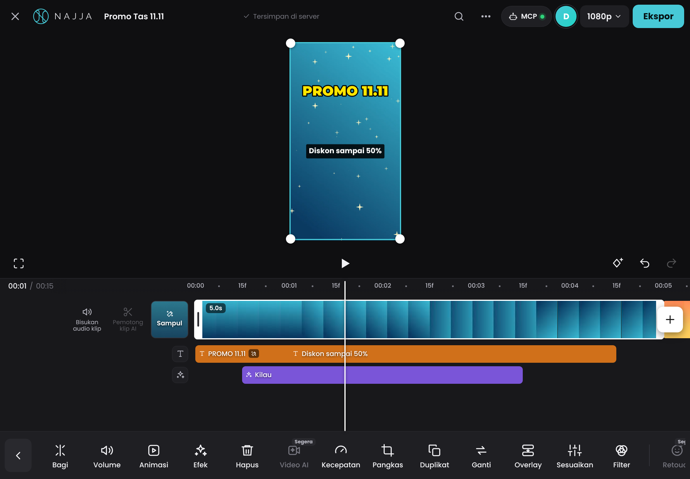

# Najja Editor

Editor video **berbasis web** bergaya CapCut, dengan **server MCP bawaan** sehingga AI agent (Claude Code, Claude Desktop, Cursor, dan lainnya) bisa mengedit video kamu secara langsung. Semua proses berjalan di browser kamu dan media tidak diunggah ke mana pun. Antarmukanya memakai font **Poppins** di semua bagian.



## Fitur

**Tata letak ramah iPad** (juga jalan di laptop dan HP)
- Atas: tutup proyek, logo NAJJA, nama proyek, cari fitur, AI · MCP, pilihan resolusi (`1080p ▾`), dan tombol **Ekspor** yang langsung merender.
- Tengah: pratinjau besar, lalu baris kontrol: layar penuh · putar · keyframe · urungkan · ulangi.
- Bawah: timeline dengan **playhead tetap di tengah**, lalu toolbar ikon besar yang berganti sesuai konteks:
  - Menu utama: Edit · Audio · Teks · Efek · Overlay · Keterangan · Filter · Sesuaikan.
  - Sub-menu per kategori, misalnya Audio → Ekstrak · Suara · Efek suara · Rekam.
  - Alat klip saat klip dipilih, misalnya Bagi · Volume · Animasi · Efek · Hapus · Kecepatan · Pangkas · Duplikat · Ganti · Overlay · Sesuaikan · Filter · Hapus Latar Belakang · Transformasi · Beku.
- Panel muncul sebagai **sheet dari bawah**; pratinjau tetap terlihat. Tombol ✓ menutupnya.
- Alat yang direncanakan tampil abu-abu dengan label *Segera*: Video AI, Retouch, Lipsync, Tiru gerakan, Ubah ekspresi, Stabilkan, Pelacakan kamera, Pisah suara, Kurangi kebisingan, Efek audio, Sempurnakan suara, Putar mundur, Tutupi (mask), dan Efek tubuh.

**Timeline**
- Playhead diam di tengah dan videonya yang bergeser:
  - Geser dengan jari (atau seret / scroll mouse) untuk scrub.
  - **Cubit dua jari** (atau Ctrl + scroll) untuk zoom.
- Track utama magnetis dengan filmstrip besar, plus tombol **Bisukan audio klip** dan **Sampul** di kirinya.
- Tombol **transisi** di antara dua klip, dan tombol **+** di kanan untuk menambah media ke akhir video.
- Lapisan lain ada di lane berwarna di bawah track utama: overlay (hijau), audio (biru kehijauan), teks (oranye), efek (ungu), filter/penyesuaian (magenta).
  - Saat tidak sedang diedit, tiap kategori diringkas jadi satu lane.
  - Saat kategorinya dibuka, semua lapisannya tampil, lengkap dengan tombol **+ Tambah**.
- Ketuk klip untuk memilih. Tarik pegangan putih di kedua ujung untuk memangkas. **Tekan lama** lalu geser untuk memindah (dengan mouse: langsung seret).
- Snapping ke playhead dan tepi klip. Undo/redo hingga 150 langkah.

**Pemutar**
- Pratinjau real-time di kanvas.
- Geser objek terpilih langsung di layar. Pegangan sudut atau **cubit dua jari** untuk memperbesar dan memutar. Garis bantu muncul di tengah.
- Rasio kanvas dipilih saat membuat proyek: 16:9, 9:16, 1:1, 4:5, 4:3, 3:4, 21:9, atau 2:1.
- Latar kanvas berupa warna atau **blur** (menu ⋯ → Pengaturan proyek).

**Video dan foto**
- Skala, posisi, rotasi, opasitas, 10 mode campuran, dan potong (crop).
- **Keyframe** untuk posisi, skala, rotasi, dan opasitas.
- **Chroma key** untuk menghapus latar hijau.
- Kecepatan 0.1x sampai 10x.
- **Pratinjau ringan**: video HP yang berat (1080p–4K, bitrate tinggi, HEVC iPhone) diputar dari salinan 720p buatan server. Hasilnya kecil diunduh, ringan di-decode, dan seek-nya instan. Ekspor tetap memakai kualitas penuh. Video yang tidak didukung browser juga dibuatkan salinan H.264 1080p untuk ekspor (butuh ffmpeg di server).
- Salinan video disimpan di perangkat (maks. 5 GB, OPFS): refresh dan buka ulang browser tidak mengunduh video lagi.
- Volume hingga 200%, fade in/out.

**Teks**
- Panel teks dengan kolom ketik dan tab **Gaya** (18 gaya), **Font**, **Warna**, dan **Animasi**.
- 19 font Google dalam 4 kelompok: Dasar, Tebal, Serif, dan Tulisan tangan. Font baru: Inter, Roboto, Instrument Serif, DM Serif Display, Righteous, Space Grotesk, dan Satisfy.
- 12 template judul beranimasi.
- Warna cepat, garis tepi, latar kotak, gradien, serta bayangan dengan geser X/Y (bisa jadi bayangan keras).

**Keterangan (subtitle)**
- Subtitle dibuat dari naskah (dibagi rata) atau dari file `.srt`.
- Teks otomatis dari suara masih *segera*.

**Animasi**
- 14 animasi masuk, 13 animasi keluar, dan 9 animasi kombo (loop).

**Stiker**
- 80 emoji dan 9 label (SUBSCRIBE, SALE, LIVE…) tetap bisa dipakai AI lewat MCP dan diedit di timeline. Menunya disembunyikan dari toolbar.

**Efek, transisi, dan filter**
- 20 efek layar penuh: glitch, VHS, getar, konfeti, salju, cinta, kilau, sinematik, dan lainnya.
- 17 transisi.
- 18 filter dengan pengaturan intensitas.
- 10 penyesuaian warna: kecerahan, kontras, saturasi, eksposur, suhu, rona, hue, pudar, vinyet, dan blur.
- **Lapisan filter dan penyesuaian**: Filter atau Sesuaikan dari menu utama mewarnai semua lapisan di bawahnya selama durasinya, dan ikut terekspor. Pada klip terpilih, filter hanya berlaku untuk klip itu.
- Efek dari toolbar klip langsung dipasang sepanjang klip tersebut.

**Audio**
- 8 efek suara dan 3 musik yang dibuat langsung di browser, tanpa file aset.
- Impor audio sendiri (MP3, WAV, M4A).
- **Ekstrak**: ambil suara dari video di pustaka.
- Rekam **voiceover** dari mikrofon.

**Ekspor**
- Pilih resolusi (480p–4K), frame rate (24–60), dan kualitas di `1080p ▾`, lalu ketuk **Ekspor**: video langsung dirender dan terunduh.
- Lewat menu ⋯ → Ekspor lanjutan: nama file, format MP4 atau WebM, dan opsi **hanya klip terpilih**.

**Proyek**
- Tersimpan otomatis **di server** (VPS kamu): proyek, media, dan hasil ekspor. Bisa dibuka dari perangkat mana pun.
- Kalau halaman dibuka tanpa server, tersimpan di browser (IndexedDB).
- Daftar proyek (tombol ✕ di kiri atas) menampilkan **sampul** pilihanmu sebagai thumbnail.
- Bisa disimpan sebagai `.json`, dan bisa dipasang sebagai aplikasi (PWA). Di iPad: Safari → Bagikan → Tambahkan ke Layar Utama.

**Tampilan**
- Tema gelap dengan aksen cyan dari logo NAJJA. Font antarmuka Poppins.
- Tombol berukuran jari, tanpa aksi yang hanya muncul saat hover.
- Tata letak menyesuaikan iPad (landscape dan potret), laptop, dan HP.

**AI · MCP**
- 24 tool, log aktivitas AI langsung di editor, dan klip yang diubah AI berkedip di timeline.

## Menjalankan

Butuh **Node.js 18.17 ke atas**. Tidak ada dependensi, jadi tidak perlu `npm install`.

```bash
npm start
```

Editor akan terbuka di **http://localhost:3333**. Gunakan **Chrome atau Edge** terbaru untuk hasil terbaik.

## Hubungkan AI lewat MCP

Tambahkan Najja Editor ke **Claude Code** (lewat HTTP):

```bash
claude mcp add --transport http najja-editor http://localhost:3333/mcp
```

Untuk **Claude Desktop, Cursor, atau klien lain** (lewat stdio), tambahkan ke konfigurasi MCP:

```json
{
  "mcpServers": {
    "najja-editor": {
      "command": "node",
      "args": ["/path/lengkap/ke/najja-editor/mcp-stdio.js"]
    }
  }
}
```

Mode stdio otomatis menyalakan server web jika belum berjalan, lalu membuka editor di browser saat AI pertama kali memakai tool. Klien yang mendukung MCP lewat HTTP bisa langsung memakai `http://localhost:3333/mcp`.

Contoh perintah ke AI:

- *"Buat video promo 15 detik rasio 9:16 dari /Users/aku/Movies/produk.mp4. Beri judul 'DISKON 50%', efek konfeti, filter Vivid, lalu ekspor 1080p."*
- *"Tambahkan subtitle dari naskah ini, posisikan di bawah, gaya Subtitle."*
- *"Cek frame di detik 3. Kalau judulnya ketutupan stiker, pindahkan stikernya."*

### Daftar tool MCP

| Tool | Fungsi |
|---|---|
| `get_project`, `list_media`, `list_assets` | Membaca proyek, media, dan daftar ID aset (filter, efek, transisi, animasi, font, dan lainnya) |
| `new_project`, `set_project` | Membuat proyek baru, mengubah rasio, fps, dan latar |
| `import_media` | Mengimpor dari URL http(s) atau path file lokal, bisa langsung masuk timeline |
| `add_media_clip`, `add_text`, `add_subtitles`, `add_sticker`, `add_solid`, `add_effect` | Menambah klip |
| `update_clip` | Mengubah properti klip apa pun (waktu, posisi, teks, gaya, filter, penyesuaian, animasi, transisi, dan lainnya) |
| `apply_filter`, `apply_transition` | Memasang filter atau transisi ke satu klip, atau `"all"` untuk semua |
| `split_clip`, `delete_clip`, `move_clip`, `duplicate_clip` | Operasi timeline |
| `playback`, `history` | Putar, jeda, lompat, urungkan, dan ulangi |
| `get_frame` | Mengembalikan **gambar** frame di waktu tertentu, supaya AI bisa melihat hasilnya |
| `export_video`, `get_export_status` | Mengekspor dan menyimpan file ke `data/exports/` |

### Variabel lingkungan

| Variabel | Default | Keterangan |
|---|---|---|
| `PORT` | `3333` | Port server |
| `HOST` | `127.0.0.1` | Alamat yang didengarkan server. Selain localhost, wajib memakai `NAJJA_TOKEN`. |
| `NAJJA_TOKEN` | | Mengaktifkan login (email + password, data terpisah per akun). MCP memakai `Authorization: Bearer <token>`: token AI pribadi (menu akun → **Token AI (MCP)**) atau token server ini (= admin pertama). **Wajib untuk VPS.** |
| `NAJJA_PUBLIC_URL` | | URL publik, misalnya `https://editor.domainkamu.com` |
| `NAJJA_DATA_DIR` | `data` | Folder data server |
| `NAJJA_EXPORT_DIR` | `data/exports` | Folder hasil ekspor dari AI |
| `NAJJA_MEDIA_DIR` | `data/media` (mode token) | Batas folder untuk `import_media` dengan `path` |
| `NAJJA_NO_OPEN` | | Isi `1` agar browser tidak dibuka otomatis |
| `NAJJA_ALLOW_ORIGINS` | | Daftar origin tambahan yang diizinkan, dipisah koma |

## Deploy ke VPS

Arahkan A record subdomain ke IP VPS, upload folder ini ke VPS, lalu jalankan:

```bash
sudo bash deploy/install.sh editor.domainkamu.com
```

Caddy otomatis memasang HTTPS, dan editor dilindungi login token. Panduan lengkap, termasuk instalasi tanpa Docker dan cara menghubungkan Claude ke VPS, ada di **[docs/DEPLOY.md](docs/DEPLOY.md)**.

## Pintasan keyboard

| Tombol | Aksi |
|---|---|
| Spasi | Putar / jeda |
| Ctrl+B atau S | Pisah klip di playhead |
| Delete | Hapus klip |
| Ctrl+D / Ctrl+C / Ctrl+V | Duplikat / salin / tempel |
| Ctrl+Z / Ctrl+Shift+Z | Urungkan / ulangi |
| ← → (Shift: 1 detik) | Geser 1 frame |
| Scroll / seret area kosong | Geser timeline (scrub) |
| Ctrl + scroll, Ctrl+= / Ctrl+-, Ctrl+0 | Zoom timeline / sesuaikan |
| Ctrl+K | Cari fitur |
| Ctrl+E / Ctrl+I / Ctrl+O | Ekspor lanjutan / tambah media / proyek saya |
| Esc | Tutup panel / kembali ke menu sebelumnya |
| ? | Daftar pintasan |

## Struktur

```
server.js          Server web + bridge MCP + endpoint /mcp (Streamable HTTP)
mcp-stdio.js       Entry MCP stdio (Claude Desktop, Cursor)
mcp/               Protokol MCP dan definisi tool
public/
  index.html, css/app.css
  js/app.js        Kerangka aplikasi (topbar, pintasan, cari fitur, ekspor, proyek)
  js/engine.js     Jam pemutaran, sinkronisasi media, mixer Web Audio
  js/render.js     Compositor kanvas: animasi, filter, lapisan penyesuaian, transisi, efek, teks, chroma key
  js/timeline.js   Timeline playhead-tengah: scrub, cubit-zoom, lane per kategori, tekan-lama-pindah
  js/toolbar.js    Toolbar bawah: menu utama, sub-menu kategori, alat per jenis klip
  js/sheet.js      Sheet bawah + pemilih media (tambah/overlay/ganti/ekstrak) + sampul
  js/player.js     Pratinjau, baris kontrol, geser/cubit objek di kanvas
  js/inspector.js  Properti klip per bagian (Volume, Animasi, Teks, Pangkas, Transformasi, …)
  js/library.js    Panel aset (musik, efek suara, rekam, template teks, keterangan, efek, transisi, filter, AI)
  js/api.js        Implementasi tool MCP di dalam editor
  js/store.js      Model proyek, undo/redo, autosave
  js/media.js      Impor instan, pilihan sumber (pratinjau ringan / kualitas ekspor), salinan di perangkat, audio sintetis
  js/devicecache.js  Salinan video permanen di perangkat (OPFS, 5 GB, LRU, bisa dilanjutkan)
  js/fastexport.js   Ekspor MP4 cepat (WebCodecs: demux, decode, encode, mux)
lib/               Penyimpanan server, akun login, salinan pratinjau 720p / H.264 1080p / thumbnail / waveform (ffmpeg)
Dockerfile, docker-compose.yml, deploy/   Deploy VPS (Docker + Caddy, atau systemd)
docs/DEPLOY.md            Panduan deploy
docs/capcut-analysis.md   Hasil analisis CapCut Web (REA) yang memandu desain
test/              npm test
```

## Catatan

- **Kelancaran edit**:
  - Impor langsung bisa dipakai (upload dan thumbnail di belakang).
  - Pratinjau memakai salinan 720p.
  - Frame pratinjau hanya digambar ulang saat videonya punya frame baru (iPad 120 Hz tidak lagi menggambar 120× per detik).
  - Resolusi pratinjau turun otomatis kalau perangkat kewalahan, lalu naik lagi.
  - Detail: [docs/DEPLOY.md](docs/DEPLOY.md#salinan-ringan-untuk-pratinjau-supaya-edit-lancar-di-semua-perangkat).
- **Ekspor MP4 cepat** dengan WebCodecs (Chrome/Edge): frame di-decode, dirender, dan di-encode H.264 secepat kemampuan perangkat (GPU), lalu file langsung terunduh; salinan ke server diupload di background. Browser tanpa WebCodecs, atau format WebM, memakai perekaman real-time (durasi ekspor ≈ durasi video). Biarkan tab editor tetap terbuka.
- MP4 dipakai jika browser bisa merekamnya (Chrome/Edge terbaru, Safari). Jika tidak, hasilnya WebM.
- Proyek dan media disimpan di server (folder `data/`, atau `NAJJA_DATA_DIR`), bukan di browser, jadi bisa dibuka dari perangkat mana pun.
- **Data per akun (v1.7):** di mode VPS setiap akun hanya melihat proyek, media, dan ekspornya sendiri; AI yang tersambung dengan token AI pribadi hanya bisa mengedit akun itu. Data dari versi sebelumnya otomatis jadi milik admin pertama, dengan cadangan di `data/backups/` (lihat [docs/DEPLOY.md](docs/DEPLOY.md#pindah-dari-v16-ke-v17-migrasi-pemilik-data)).
- Belum tersedia (tampil abu-abu *Segera* di toolbar):
  - Butuh pemrosesan di server: putar mundur, stabilkan, pisah suara, kurangi kebisingan.
  - Butuh model AI: hapus latar otomatis, retouch, lipsync, teks otomatis dari suara.
  - Mask (Tutupi), efek audio, efek tubuh, dan pelacakan kamera.
- Najja Editor meniru **tata letak dan alur kerja** editor video populer, tetapi seluruh kode, ikon, dan desainnya dibuat sendiri. Tidak ada kode, aset, atau merek CapCut yang dipakai. Lihat `docs/capcut-analysis.md`.

## Tes

```bash
npm test
```

Tes end-to-end di browser (butuh Playwright + Chromium dan ffmpeg; dilewati otomatis kalau tidak ada). Tes ini memastikan `get_frame` mengembalikan frame yang tepat pada panggilan pertama, walaupun videonya ber-GOP panjang dan di-stream dari server lewat koneksi 8 Mbps:

```bash
npm run test:e2e
```

Tes yang sama juga menjalankan `test/e2e/ipad-ui.mjs`. Tes ini membuka editor di ukuran iPad dengan input sentuh, lalu mengecek:
- playhead di tengah, geser = scrub, dan cubit dua jari = zoom;
- toolbar 3 tingkat, sheet Volume dan Teks, serta tekan-lama-geser;
- tombol transisi, Ganti, Ekstrak, dan Sampul;
- lapisan filter yang benar-benar mewarnai frame;
- tata letak iPad potret.
