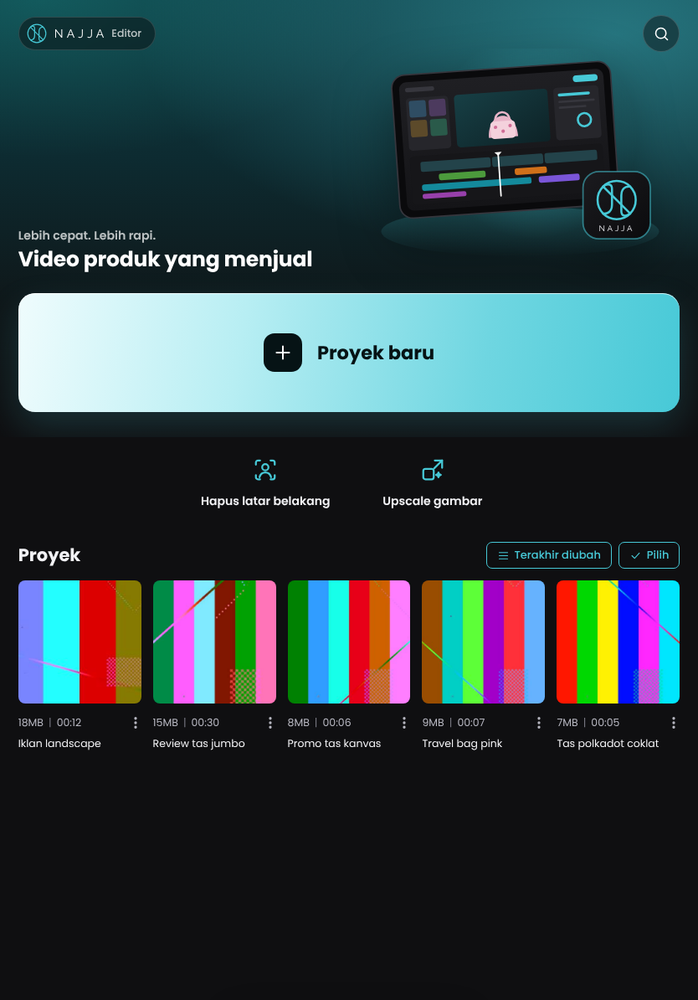

# Beranda & alat AI (v1.8)

## Beranda



Najja kini dibuka di **beranda**, bukan langsung di proyek terakhir. Susunannya mengikuti beranda editor video di tablet, dengan warna, font (Poppins), dan ilustrasi Najja sendiri. Isinya dari atas ke bawah:

- Hero dengan pill logo NAJJA dan tombol **cari proyek**.
- Kartu besar **Proyek baru** (pilih nama dan rasio).
- Dua alat: **Hapus latar belakang** dan **Upscale gambar**.
- Grid **Proyek**. Setiap kartu menampilkan thumbnail, ukuran media dan durasi ("18MB | 00:12"), nama proyek, dan menu ⋮ (Buka, Ganti nama, Duplikat, Hapus). Proyek yang sedang terbuka di editor diberi bingkai teal.
  - **Urutkan:** terakhir diubah, terakhir dibuat, nama, atau ukuran.
  - **Pilih:** tandai beberapa proyek, lalu hapus sekaligus.
- Tidak ada tab bawah (Template/Lab AI/Kotak Masuk/Saya).

Cara berpindah antara beranda dan editor:
- Tombol **X** di kiri atas editor, menu ⋯ → *Beranda*, atau Ctrl+O: kembali ke beranda (proyek disimpan dulu).
- Membuka proyek menambahkan `?p=<id>` ke alamat. Reload di editor tetap di proyek itu; membuka alamat tanpa `?p=` dimulai di beranda.
- Perintah AI lewat MCP saat beranda tampil: editor otomatis membuka proyek terakhir di perangkat itu (atau proyek terbaru, atau proyek baru), lalu perintahnya dijalankan.
- Proyek kosong di belakang beranda tidak pernah disimpan, kecuali diedit.

## Alat AI

Dua alat untuk thumbnail video. Pemrosesannya terjadi **di server Najja sendiri**, tidak ada layanan berbayar atau pihak ketiga.

| Alat | Hasil | Model | Waktu (VPS 2 CPU) |
|---|---|---|---|
| Hapus latar belakang | PNG transparan, resolusi asli (maks. 4096 px) | BiRefNet lite 512 (MIT); di VPS dengan RAM < 6 GB: IS-Net (MIT) | ±4–6 dtk; 1 CPU ±8 dtk |
| Upscale gambar | 2× atau 4×, JPEG kualitas 95 (PNG kalau transparan), maks. 4096 px | Real-ESRGAN General x4v3 (BSD-3) | 500×820 → 2×: ±7 dtk; 1 CPU ±14 dtk |

Alurnya di iPad:
1. Ketuk alatnya, lalu **Pilih foto**. Foto diputar sesuai EXIF dan dikecilkan ke ukuran maksimum di perangkat sebelum dikirim.
2. Ikuti progresnya; tombol **Batal** menghentikan pekerjaan di server.
3. Hasil ditampilkan dengan slider **Asli | Hasil**. Ketuk gambar untuk zoom.
4. **Simpan** membuka menu Bagikan di iPad/iPhone; pilih *Simpan Gambar* untuk menyimpan ke Foto. Di browser lain, hasilnya diunduh.
5. **Tambahkan ke proyek**: pilih proyek (atau proyek baru); gambarnya masuk ke Media proyek itu.

Data permintaan disimpan per akun di `data/ai/<id>/` (akun lain tidak bisa melihatnya) dan dihapus otomatis setelah 3 hari.

### Cara kerja di server

```
editor (iPad) ── POST /api/ai/cutout|upscale ──► Najja (Node) ── job "ai" (1 per waktu) ──► layanan AI (Python, onnxruntime)
                ◄── GET /api/ai/<id> (progres) ──                ◄── progres NDJSON ──────────    data/ai/<id>/input → result
```

- Layanan AI (`ai/server.py`) adalah **container terpisah** (`Dockerfile.ai`, service `ai` di `docker-compose.yml`). Kalau model kehabisan memori, hanya container AI yang dimulai ulang; editor dan pekerjaan video tidak ikut berhenti.
- Node (`lib/ai.js`) hanya berbicara HTTP dengannya (`NAJJA_AI_URL`, dilindungi token server). Path berkas dikirim relatif terhadap `data/ai`.
- **Memori:**
  - Layanan AI membaca batas memori container-nya. BiRefNet dipakai kalau batasnya ≥ 2,4 GB; kalau kurang, IS-Net.
  - Puncak terukur: BiRefNet 512 ±2,0 GB; IS-Net ±0,7 GB; upscale ±0,1–0,4 GB.
  - BiRefNet di 1024 px butuh 6–7 GB, jadi sengaja tidak dipakai.
- **CPU:** jumlah thread mengikuti kuota CPU container. Lebih banyak thread hanya saling menunggu (1 CPU: 13 dtk → 8 dtk setelah diperbaiki).
- **Model** diunduh sekali ke `data/models` (±200 MB) dari sumber resminya, dikunci ke revisi tertentu dan dicek sha256 (`ai/models.json`). Model yang sedang tidak dipakai dilepas dari memori setelah 5 menit.

### Deploy

Installer (`deploy/install.sh`) memasang container AI otomatis dan memilih batasnya dari ukuran VPS. Nilai yang dipilih disimpan di `.env`:

| RAM VPS | `NAJJA_AI_MEM` | Hapus latar |
|---|---|---|
| ≥ 6 GB | 2560m | BiRefNet (kualitas tinggi) |
| < 6 GB | 1280m | IS-Net (ringan) |

- `NAJJA_AI_CPUS` bernilai 2.0 kalau VPS punya ≥ 4 core, selain itu 1.0.
- Mengubah sendiri: edit `.env` (misalnya `NAJJA_AI_MEM=2560m` untuk kualitas tinggi di VPS 4 GB yang longgar), lalu jalankan installer lagi. Nilai di `.env` tidak ditimpa.
- Tanpa alat AI: tambahkan `--tanpa-ai` ke perintah installer. Beranda tetap ada; alatnya tampil "belum tersedia".
- Cek status: `docker compose logs ai`, atau Diagnostik → *Antrean server* (job "Alat AI").
- **Tanpa Docker (PC):**
  - `node server.js` menjalankan layanan AI sendiri kalau ada `python3` dengan `onnxruntime numpy pillow`.
  - Model diunduh saat alat pertama kali dipakai.
  - `NAJJA_AI=off` mematikannya; `NAJJA_AI_MODELS=<folder>` memakai folder model yang sudah ada.

### Lisensi model

- BiRefNet (Zheng Peng dkk.), konversi ONNX `studioludens/birefnet-lite-512`: MIT.
- IS-Net / DIS (Xuebin Qin dkk.), konversi ONNX `imgly/isnet-general-onnx`: MIT.
- Real-ESRGAN (Xintao Wang dkk.), ekspor ONNX resmi Qualcomm AI Hub `real_esrgan_general_x4v3` v0.66.0: BSD-3-Clause.

Model berlisensi non-komersial (misalnya RMBG dari BRIA) sengaja tidak dipakai.

### Tes

- `test/ai.test.js`:
  - permintaan per akun (format gambar, akun lain tidak bisa melihat atau menghapus);
  - hapus latar dengan model asli: dinding transparan, tas tidak;
  - upscale 2×/4×.
  - Butuh `NAJJA_AI_MODELS`; tanpa itu, cek model dilewati.
- `test/e2e/home.mjs`:
  - beranda sebagai layar pertama, proyek baru, X, reload `?p=`, ganti nama, duplikat, hapus banyak, hapus proyek yang sedang terbuka;
  - perintah MCP dari beranda;
  - alat AI di browser sampai *Tambahkan ke proyek*;
  - tata letak iPad potret/lanskap dan ponsel.
- Container AI diuji dengan batas 2560m (BiRefNet) dan 1280m (IS-Net) tanpa OOM, lalu dihubungkan ke server Node lewat `NAJJA_AI_URL` + token.
