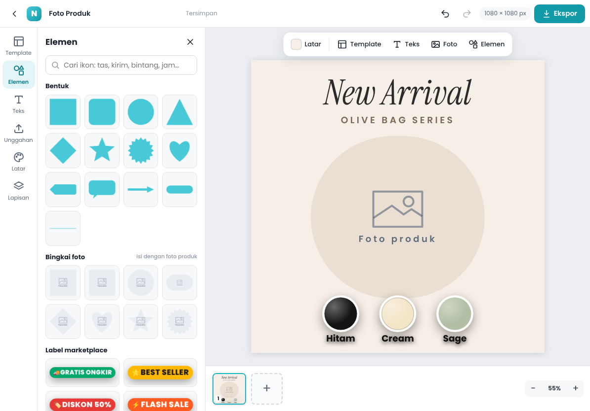
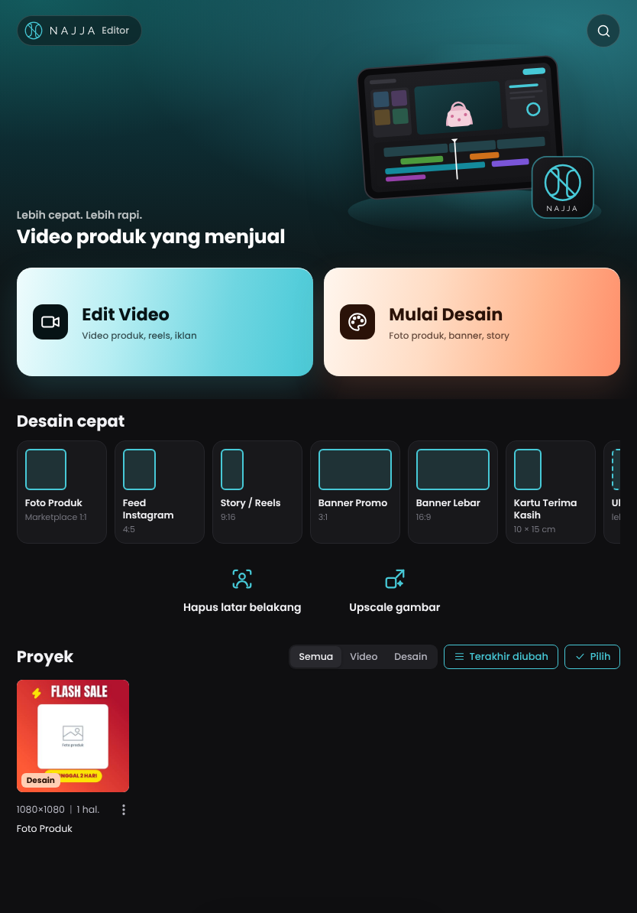

# Najja Desain (v1.13)

Najja Desain adalah editor desain gambar di dalam Najja, untuk konten **marketplace**: foto produk, feed, story, banner promo, dan kartu terima kasih. Tata letaknya mengikuti aplikasi desain tablet: menu di kiri, panel isi di sampingnya, toolbar elemen di atas halaman, dan strip halaman di bawah. Template, warna, ikon antarmuka, dan kodenya dibuat sendiri untuk Najja.

## Cara mulai

Beranda Najja punya dua kartu besar:

- **Edit Video**: editor video seperti biasa.
- **Mulai Desain**: pilih ukuran, lalu halaman desain terbuka.

Di bawahnya ada **Desain cepat**, yaitu ukuran siap pakai:

| Ukuran | Piksel | Untuk |
|---|---|---|
| Foto Produk | 1080 × 1080 | Foto utama marketplace (Shopee, Tokopedia, TikTok Shop) |
| Feed Instagram | 1080 × 1350 | Postingan 4:5 |
| Story / Reels | 1080 × 1920 | Story, cover Reels/TikTok |
| Banner Promo | 1920 × 640 | Banner toko 3:1 |
| Banner Lebar | 1920 × 1080 | Banner 16:9 |
| Kartu Terima Kasih | 1181 × 1772 | Kartu cetak 10 × 15 cm (300 dpi) |
| Ukuran khusus | 64–8000 px | Lebar × tinggi sendiri |

Desain tersimpan sebagai proyek di server, sama seperti video. Desain muncul di grid **Proyek** dengan label **Desain** dan jumlah halaman, dan bisa disaring lewat tombol **Semua / Video / Desain**. Ganti nama, duplikat, dan hapus juga berlaku untuk desain.

## Panel (menu kiri)

| Panel | Isi |
|---|---|
| **Template** | 10 template marketplace: Diskon Besar, Koleksi Baru, Best Seller, Fitur Produk, Varian Warna, Bundling Hemat, Flash Sale, Story Promo, Banner Promo, Kartu Terima Kasih. Template untuk ukuran desain tampil paling atas; yang lain otomatis menyesuaikan. Di halaman kosong template langsung dipakai; di halaman berisi, template jadi halaman baru. |
| **Elemen** | Bentuk (13), **bingkai foto** (8), label marketplace (Gratis Ongkir, Best Seller, Diskon, Flash Sale, COD, Ori 100%, Stok Terbatas…), bulatan warna varian, ikon **Lucide** (±1.600, bisa dicari dengan kata Indonesia seperti *tas, kirim, bintang, hadiah, jam*), dan emoji. |
| **Teks** | Tambah kotak teks, judul / subjudul / isi, dan 8 kombinasi teks marketplace (harga coret, diskon, koleksi baru, flash sale, gratis ongkir, ulasan bintang, judul produk, ajakan beli). |
| **Unggahan** | Unggah foto (bisa banyak sekaligus) dan daftar foto desain ini. Kalau bingkai foto sedang dipilih, ketuk foto untuk mengisinya. |
| **Latar** | Warna, gradasi, atau foto sebagai latar, dan tombol untuk memakai latar yang sama di semua halaman. |
| **Lapisan** | Urutan elemen (paling atas = paling depan): sembunyikan, kunci, maju, mundur. |

## Toolbar elemen (berubah sesuai yang dipilih)

- **Teks**:
  - font (25 font, bisa dicari), ukuran, warna atau gradasi;
  - tebal, miring, rata kiri/tengah/kanan, huruf besar, jarak huruf dan baris;
  - **Efek**: Bayangan, Angkat, Berongga, Sambung, Garis tepi, Gema, Glitch, Neon, dan Latar (kotak di belakang teks). Tiap efek punya pengaturan jarak, kekuatan, dan warna;
  - **Lengkung**: teks satu baris jadi melengkung ke atas atau ke bawah.
- **Foto**:
  - Ganti dan **Hapus latar**. Hapus latar memakai layanan AI server yang sama dengan beranda, dan hasilnya jadi foto baru tanpa mengubah aslinya;
  - Filter (24) dan Sesuaikan (kecerahan, kontras, saturasi, suhu, dll.);
  - Potong, **Bingkai** (lingkaran, sudut bulat, kapsul, hati, bintang…), Bayangan (paling bagus untuk produk yang latarnya sudah dihapus), dan Balik.
- **Bentuk**: warna atau gradasi, garis tepi (garis / putus-putus), sudut bulat, bayangan.
- **Bingkai foto**: tombol **Pilih foto**. Foto otomatis dipotong pas seukuran bingkai (tidak gepeng) dan mengikuti bentuknya. Menu ⋯ → *Kosongkan bingkai* mengembalikannya ke bingkai kosong.
- **Ikon**: warna garis, warna isi, ketebalan.
- **Label**: ubah teks dan emoji, warna latar dan warna teks.
- **Bulatan warna**: warna, nama, dan warna nama.
- Untuk semua jenis: Transparansi, Posisi (urutan lapisan, ratakan ke halaman, putar), Kunci, Duplikat, Hapus, dan menu ⋯ (salin, tempel, jadikan latar halaman, dll.).

## Di kanvas

- **Ketuk** untuk memilih; ketuk teks yang sudah dipilih (atau ketuk dua kali) untuk **mengetik langsung** di halaman.
- **Geser** untuk memindah. Saat mendekati tengah, tepi halaman, atau tepi/tengah elemen lain, elemen menempel dan muncul **garis bantu** merah muda. Tahan Alt untuk tidak menempel.
- **Sudut** untuk mengubah ukuran. **Sisi** mengubah lebar kotak teks (teks turun baris) atau lebar/tinggi bentuk. Pegangan **putar** di bawah elemen menempel di 0/45/90°.
- **Dua jari**: cubit untuk zoom dan geser halaman. Satu jari di area kosong menggeser halaman (dengan mouse: kotak untuk memilih banyak elemen).
- **Tekan lama** (atau klik kanan) membuka menu: salin, tempel, duplikat, hapus, depan/belakang, kunci.
- Foto juga bisa ditarik dari Finder/Files ke halaman (jatuh di bingkai = mengisi bingkai), atau ditempel dari clipboard.
- Pintasan keyboard:

  | Tombol | Fungsi |
  |---|---|
  | Ctrl/⌘ + Z | Urungkan |
  | Ctrl/⌘ + Shift + Z | Ulangi |
  | Ctrl/⌘ + D | Duplikat |
  | Ctrl/⌘ + C / V / X | Salin / tempel / potong |
  | Ctrl/⌘ + A | Pilih semua |
  | Del | Hapus |
  | Panah | Geser 1 px (Shift: 10 px) |
  | Enter | Edit teks |
  | Esc | Batal pilih |
  | Ctrl/⌘ + = / − / 0 | Zoom |

## Halaman dan ekspor

- Strip bawah menampilkan semua halaman. **+** menambah halaman. Mengetuk halaman aktif membuka menu: duplikat, tambah kosong, geser kiri/kanan, hapus.
- **Ekspor**:
  - format **PNG**, **JPG** (file kecil untuk marketplace), atau **PNG transparan** (tanpa warna latar);
  - ukuran 1× atau 2×;
  - halaman ini saja atau **semua halaman dalam satu ZIP**;
  - di iPad, **Bagikan → Simpan Gambar** menaruh hasilnya di Foto.
- Ekspor memakai foto asli (bukan salinan ringan di layar), jadi hasilnya tajam.

## Cara kerjanya (teknis)

- **Satu renderer untuk video dan desain.** Elemen desain adalah klip editor video tanpa waktu (teks, foto, stiker, bentuk). Halaman digambar oleh `render.js drawVisualClip`, jadi layar, thumbnail halaman, dan file ekspor identik. Fitur baru di renderer:
  - kotak teks yang membungkus kata, teks lengkung, dan efek teks;
  - bentuk dan bingkai foto, foto dengan bingkai, bayangan produk;
  - ikon vektor dari data Lucide.
- **Halaman sendiri yang ringan.** `/design` (`public/design.html`) hanya memuat renderer dan modul `js/design/`, bukan editor video.
  - Siap dipakai ±0,3 detik setelah dibuka.
  - Saat menggeser, elemen di bawah dan di atas disimpan sebagai dua gambar, jadi hanya yang bergerak yang digambar ulang (±0,1 ms per frame).
  - Kanvas memakai resolusi layar (maksimal 2× dan 16 MP), dan foto di layar memakai salinan ≤ 2048 px.
- **Data.**
  - Desain adalah proyek `kind: "design"` dengan `pages: [{ id, bg, els }]`. Posisi elemen dicatat sebagai pecahan halaman, ukurannya dalam piksel.
  - Disimpan otomatis ±0,7 detik setelah setiap perubahan, dengan revisi yang sama seperti video. Kalau perangkat lain sempat menyimpan, editor menanyakan versi mana yang dipakai.
  - Foto masuk pustaka media server yang sama dengan video. Foto di atas 6000 px diperkecil saat diimpor.
- **Urungkan/ulangi.** Snapshot seluruh dokumen, hingga 80 langkah. Geser slider atau panah berturut-turut dihitung satu langkah.
- **Ikon.** Lucide `lucide-static` 1.76.0 (lisensi ISC, https://lucide.dev).
  - Server mengunduhnya sekali dari npm dengan versi terkunci dan memeriksa sha256-nya (`lib/vendor.js`).
  - Disajikan dari `/vendor/lucide-1.76.0/`, sudah di-gzip (±180 KB), dan hanya dimuat saat panel Elemen dibuka.
  - Browser tidak memuat apa pun dari CDN.

## Modul

| File | Isi |
|---|---|
| `public/js/design/model.js` | Dokumen desain, ukuran, pembuat elemen, isi bingkai, geometri (tempel, ratakan, sebarkan), riwayat. Murni, diuji di Node. |
| `public/js/design/templates.js` | Template dan kombinasi teks marketplace. |
| `public/js/design/draw.js` | Menggambar halaman dengan renderer video. |
| `public/js/design/stage.js` | Kanvas: zoom, seleksi, pegangan, garis bantu, sentuh, edit teks di tempat. |
| `public/js/design/ui.js` | Panel, toolbar elemen, popover, strip halaman, dialog ekspor. |
| `public/js/design/assets.js` | Foto (impor, unggah, salinan ringan, Hapus latar) dan ikon Lucide. |
| `public/js/design/zip.js` | Penulis ZIP kecil (semua halaman dalam satu file). |
| `public/js/design/app.js` | Memuat, menyimpan, urungkan, perintah, ekspor. |

Tes: `test/design.test.js` (unit) dan `test/e2e/design.mjs` (browser). Tes browser mencakup:
- beranda → ukuran → teks diketik, font, warna, efek, lengkung;
- bentuk, ikon, label, impor foto ke server, bingkai lingkaran;
- geser dengan garis bantu, ubah ukuran, urungkan/ulangi;
- halaman 2 dengan template dan bingkai yang diisi;
- ekspor PNG dan ZIP (piksel dicek), muat ulang, kartu di beranda;
- tata letak iPad potret dan ponsel.
